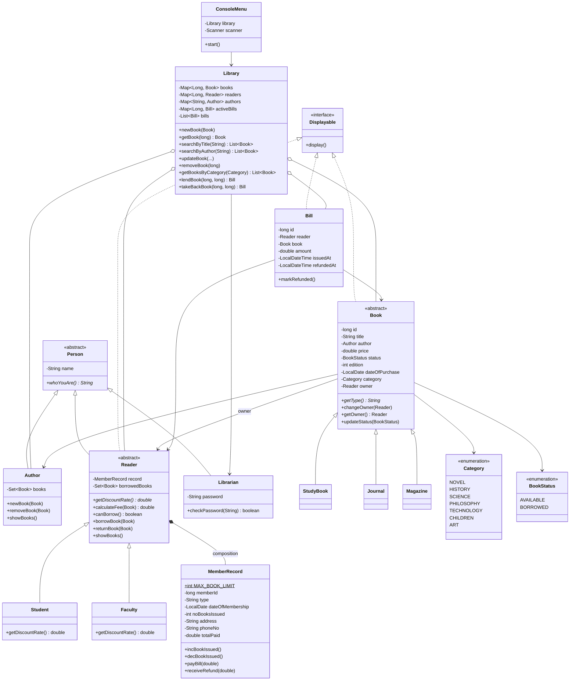

# Kütüphane Otomasyonu (Java OOP)

Workintech S15 Challenge: Java ile nesne tabanlı tasarlanmış, konsoldan kullanılan bir kütüphane otomasyonu.
Kütüphane görevlisi kitap ekleyip güncelleyebilir, arayabilir, silebilir; üyelere kitap ödünç verip iade alabilir.
Ödünç verilen her kitap için fatura kesilir, kitap iade edilince ücret üyeye geri ödenir.

## Çalıştırma

1. Projeyi IntelliJ IDEA ile açın (JDK 17 veya üstü).
2. `src/Main.java` dosyasını çalıştırın.
3. Kütüphaneci şifresi: **`1234`**

Terminalden çalıştırmak için:

```bash
javac -encoding UTF-8 -d out $(find src -name "*.java")
java -cp out Main
```

Uygulama örnek verilerle açılır: 14 kitap (kitap, akademik dergi, magazin) ve 3 üye (2 öğrenci, 1 akademisyen).

## Özellikler

| Menü | İşlem |
|---|---|
| 1 | Tüm kitapları listele |
| 2 | Yeni kitap ekle (tür, ad, yazar, fiyat, baskı, kategori) |
| 3 | Kitap seç: id, isim veya yazara göre (büyük/küçük harf duyarsız, kısmi eşleşme) |
| 4 | Kitap bilgilerini güncelle (boş bırakılan alan değişmez) |
| 5 | Kitap sil (ödünçteki kitap silinemez) |
| 6 | Bir kategorideki tüm kitapları listele |
| 7 | Bir yazarın tüm kitaplarını listele |
| 8 | Kitap ödünç ver ve fatura kes |
| 9 | Kitap iade al ve ücreti geri öde |
| 10 | Ödünçteki kitapları ve kimde olduklarını listele |
| 11 / 12 | Üyeleri listele / yeni üye ekle |
| 13 | Fatura geçmişi |

**Kurallar**

- Kitap ancak raftaysa (başka bir üyede değilse) ödünç verilebilir. Kitabın hangi üyede olduğu tutulur.
- Her üyenin **en fazla 5 kitap** limiti vardır. Limit dolunca yeni kitap alamaz.
- Ödünç ücreti kitap fiyatı üzerinden hesaplanır: **öğrenciler %50, akademisyenler %20 indirim** alır.
- İade edilince fatura "iade edildi" olarak işaretlenir ve aynı tutar üyeye geri ödenir.
- Hatalı girişler (harf yerine sayı, boş alan, geçersiz menü seçimi) programı çökertmez, tekrar sorulur.

## Paket yapısı

```
src
├── Main.java                         Uygulamanın giriş noktası
└── com/workintech/library
    ├── model
    │   ├── Displayable.java          Konsola yazdırılabilen nesneler için arayüz
    │   ├── book                      Book (abstract), StudyBook, Journal, Magazine, Category, BookStatus
    │   ├── person                    Person (abstract), Author, Reader (abstract), Student, Faculty, Librarian
    │   ├── member                    MemberRecord (üyelik kaydı ve 5 kitap limiti)
    │   └── billing                   Bill (fatura)
    ├── service                       Library: veri saklama ve tüm iş kuralları
    ├── exception                     LibraryException
    ├── data                          SampleData: başlangıç verileri
    └── ui                            ConsoleMenu: Scanner ile menü
```

## Sınıf diyagramı



## OOP gereksinimleri nerede karşılandı?

| Gereksinim | Projede karşılığı |
|---|---|
| En az 10 sınıf | 17 sınıf, 1 arayüz ve 2 enum (yukarıdaki diyagram) |
| Anlamlı paketler | `model`, `service`, `ui`, `data`, `exception` |
| Encapsulation | Tüm alanlar `private`. Değişmemesi gerekenler (`id`, `dateOfPurchase`, `memberId`) `final` ve setter'ı yok. Koleksiyonlar dışarıya `Collections.unmodifiable...` ile verilir. |
| Composition | Her `Reader`, kendi `MemberRecord` nesnesini constructor içinde oluşturur. Kayıt okuyucudan ayrı yaşamaz. |
| Inheritance | `Person` → `Author`, `Reader`, `Librarian`; `Reader` → `Student`, `Faculty`; `Book` → `StudyBook`, `Journal`, `Magazine` |
| Abstract class / Interface | Abstract: `Person`, `Reader`, `Book`. Interface: `Displayable` (`Book`, `Reader`, `Bill` uygular). |
| Polymorphism | `calculateFee()` üye türüne göre farklı indirim uygular (`getDiscountRate()`). `whoYouAre()` ve `getType()` her alt sınıfta farklıdır. `ConsoleMenu.printAll(Collection<? extends Displayable>)` kitap, üye ve fatura listelerini tek metodla yazdırır. |
| List | Arama ve listeleme sonuçları, fatura geçmişi (`List<Bill>`) |
| Set | `Reader.borrowedBooks` ve `Author.books`: aynı kitap bir üyede veya yazarda iki kez görünemez (`Book.equals/hashCode` id üzerinden). |
| Map | Kitaplar, üyeler, yazarlar ve aktif faturalar `Library` içinde Map'lerde saklanır. |
| Konsol uygulaması | `Scanner` ile menü (`ConsoleMenu`) |
