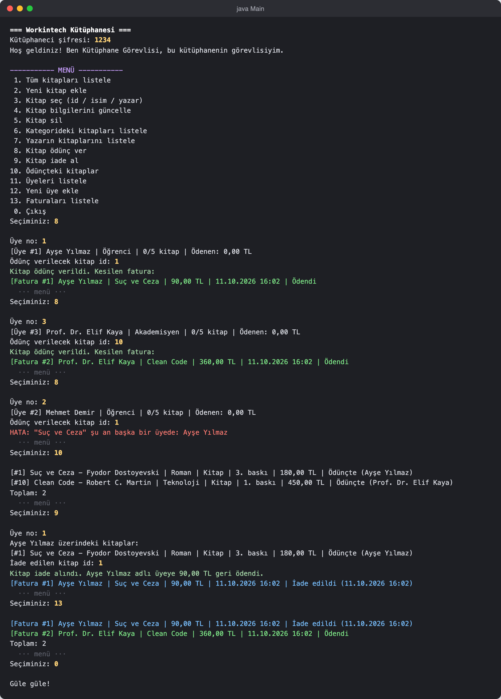
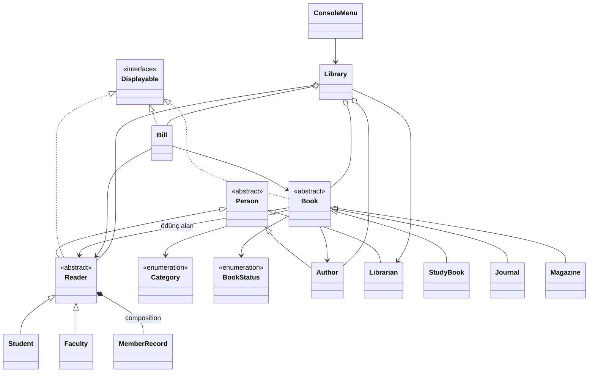

# Kütüphane Otomasyonu (Java OOP)

Workintech S15 Challenge: Nesne tabanlı olarak tasarlanmış, konsoldan kullanılan bir kütüphane otomasyonu.
Kütüphane görevlisi kitapları yönetir, üyelere ödünç verir ve fatura keser. Kitap iade edilince ücret üyeye geri ödenir.



## Çalıştırma

IntelliJ IDEA ile projeyi açıp `src/Main.java` dosyasını çalıştırın (JDK 17 veya üstü). Terminalden:

```bash
javac -encoding UTF-8 -d out $(find src -name "*.java")
java -cp out Main
```

Kütüphaneci şifresi **`1234`**. Uygulama örnek verilerle açılır: 14 yayın ve 3 üye.

## İsterler

**Tasarım**

| İster | Projede karşılığı |
|---|---|
| En az 10 sınıf | 17 sınıf, 1 arayüz, 2 enum |
| Hiyerarşinin çizili gösterimi | Aşağıdaki sınıf diyagramı |
| Anlamlı paketler | `model`, `service`, `ui`, `data`, `exception` |
| Encapsulation | Alanlar `private` (tek istisna `MAX_BOOK_LIMIT` sabiti), değişmemesi gerekenler `final`. Koleksiyonlar dışarıya salt okunur verilir. |
| Composition | Her `Reader` kendi `MemberRecord` nesnesini oluşturur, kayıt okuyucudan ayrı yaşamaz. |
| Inheritance | `Person` → `Author`, `Reader`, `Librarian` · `Reader` → `Student`, `Faculty` · `Book` → `StudyBook`, `Journal`, `Magazine` |
| Abstract class / Interface | Abstract: `Person`, `Reader`, `Book` · Interface: `Displayable` |
| Polymorphism | Ödünç ücreti üye türüne göre farklı indirimle hesaplanır (`getDiscountRate()`). Kitap, üye ve fatura listeleri tek bir metotla yazdırılır. |
| List | Arama sonuçları ve fatura geçmişi |
| Set | Bir üyedeki ve bir yazardaki kitaplar: aynı kitap iki kez yer alamaz. |
| Map | Kitaplar, üyeler, yazarlar ve aktif faturalar `Library` içinde Map'lerde saklanır. |

**İşlevler** (konsol menüsü, `Scanner` ile)

| İster | Menü |
|---|---|
| Yeni kitap ekleme | 2 |
| Id, isim veya yazara göre kitap seçme | 3 |
| Kitap bilgilerini güncelleme | 4 |
| Kitap silme (ödünçteki kitap silinemez) | 5 |
| Bir kategorideki kitapları listeleme | 6 |
| Bir yazarın kitaplarını listeleme | 7 |
| Ödünç verme: kitap rafta değilse verilmez, kimde olduğu tutulur, fatura kesilir | 8, 10 |
| İade alma ve ücreti geri ödeme | 9 |
| 5 kitap limiti | 8 |

Öğrenciler %50, akademisyenler %20 indirimli öder. Hatalı girişler (sayı yerine harf, boş alan, geçersiz seçim) programı çökertmez.

## Sınıf diyagramı



## Paket yapısı

```
src/com/workintech/library
├── model       Book, Person ve alt sınıfları, MemberRecord, Bill, Displayable
├── service     Library: veriler ve bütün iş kuralları
├── ui          ConsoleMenu: konsol menüsü
├── data        SampleData: başlangıç verileri
└── exception   LibraryException
```
